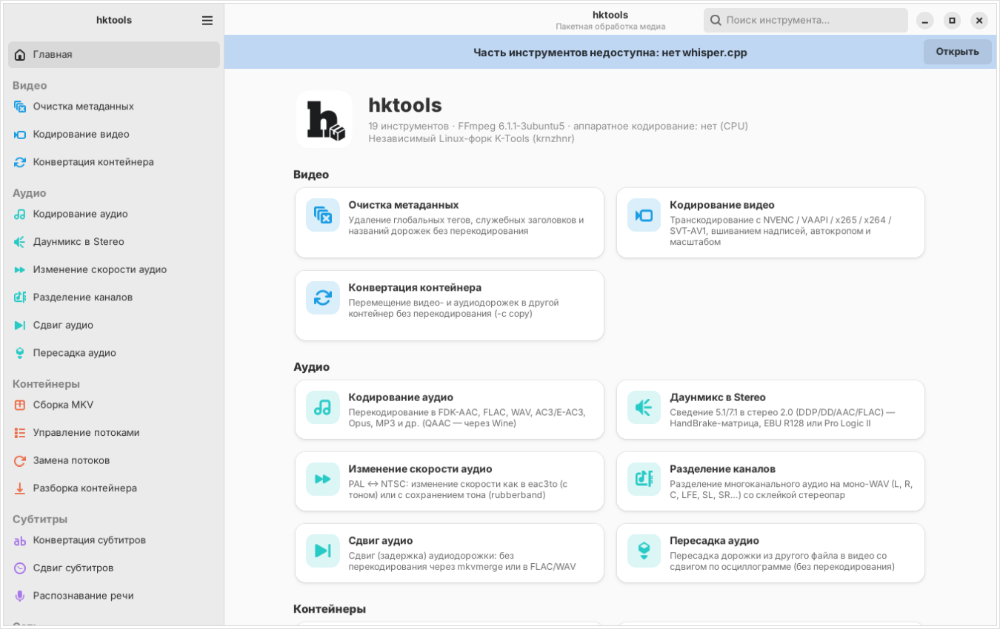
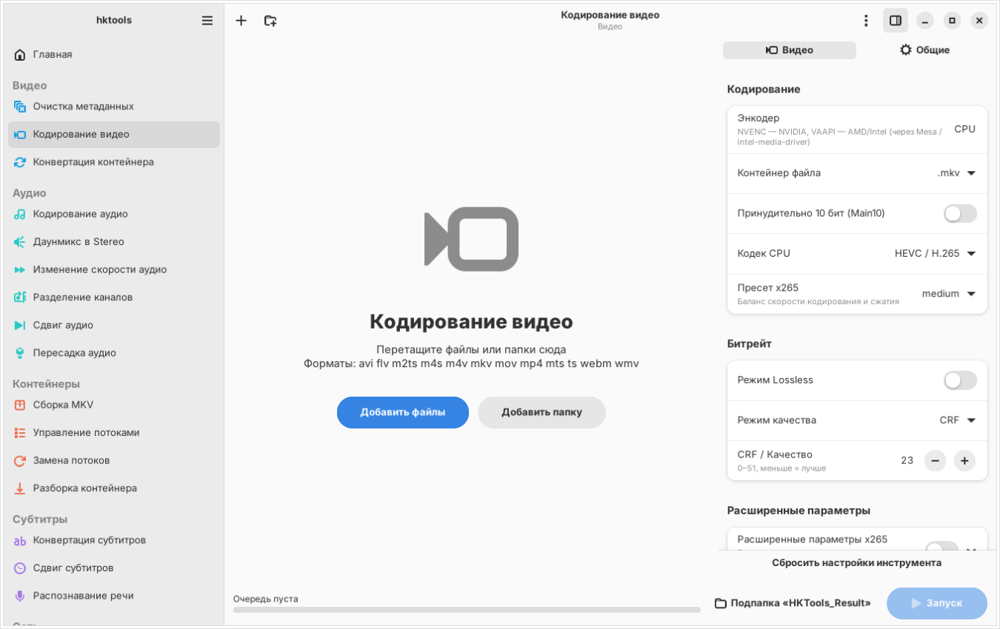
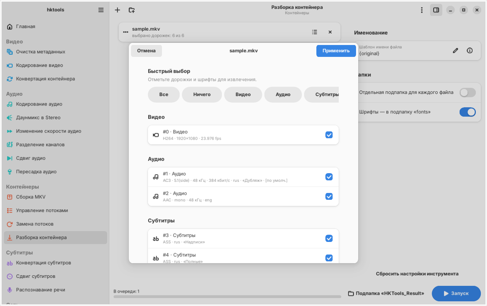
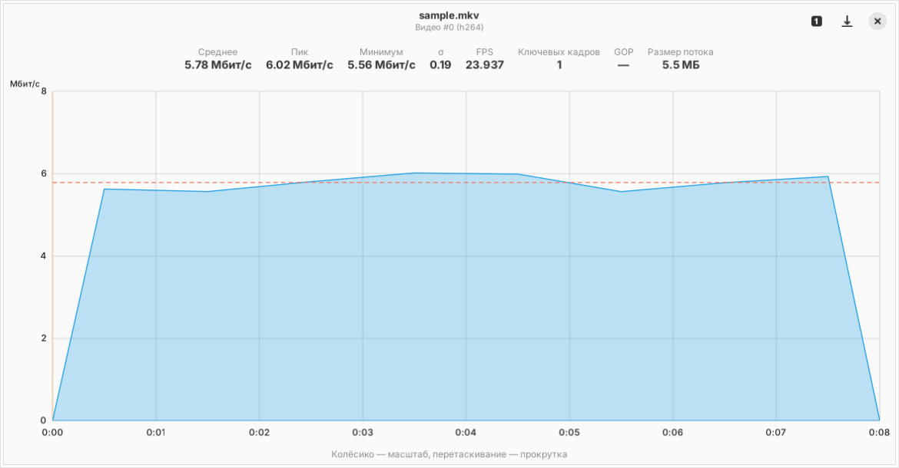

<p align="center">
  
</p>

<h1 align="center">hktools</h1>

<p align="center">Пакетная обработка медиа для Linux: кодирование, ремукс MKV, субтитры, Whisper, yt-dlp</p>

> **hktools — независимый форк [K-Tools](https://github.com/krnzhnr/k-tools) (автор — krnzhnr),
> переписанный с нуля под Linux.** Это не официальная версия K-Tools и не связана с её автором;
> название и иконка изменены, чтобы проекты не путали. Оригинал распространяется по лицензии MIT,
> его авторские права сохранены в [LICENSE](LICENSE) и [NOTICE.md](NOTICE.md).
> Ошибки этой версии — в [Issues этого репозитория](https://github.com/zerosensee/h-ktools-linux/issues),
> а не автору K-Tools.

hktools рассчитан на **Arch Linux, CachyOS и Ryoku** с **Hyprland**
(работает и в niri, Sway, GNOME, KDE — везде, где есть GTK4).

Оригинальный K-Tools написан на C# / WinUI 3 и использует встроенные `.exe` (eac3to, qaac, DEE, Win2D).
hktools повторяет его функциональность на нативном стеке Linux:

| K-Tools (Windows) | hktools (Linux) |
|---|---|
| WinUI 3, Mica, Win2D | **GTK4 + libadwaita**, Cairo; тема GTK (в т.ч. matugen на Ryoku) |
| Встроенные бинарники в `bin/` | Пакеты дистрибутива: `ffmpeg`, `mkvtoolnix-cli`, `yt-dlp`, `whisper.cpp` (AUR) |
| NVENC | **NVENC + VAAPI** (AMD/Intel) + CPU: x265, x264, **SVT-AV1** |
| eac3to (скорость, сдвиг, каналы) | ffmpeg (`asetrate`/`rubberband`, `channelsplit`) и **mkvmerge `--sync`** — сдвиг бит-в-бит |
| qaac (Apple AAC) | **fdkaac** (FDK-AAC/HE-AAC); qaac можно подключить через Wine |
| Dolby Encoding Engine | ffmpeg: матрица HandBrake, EBU R128, Dolby Pro Logic II |
| Контекстное меню Проводника | `.desktop` (Открыть с помощью), сервис-меню Dolphin, действия Thunar |
| Прогресс в панели задач | **уведомления** (mako/swaync/dunst) и **модуль Waybar / Quickshell** |
| — | **CLI**: любой инструмент без GUI, удобно для скриптов и биндов Hyprland |

<p align="center">
  
  
  
  
</p>

---

## 📂 Инструменты (18 + калькулятор)

### 🎞️ Видео
* **Кодирование видео** — NVENC (HEVC/H.264/AV1), VAAPI (HEVC/H.264/AV1), CPU x265/x264/SVT-AV1;
  10 бит, lossless; вшивание надписей (ASS со встроенными шрифтами, PGS/VobSub через overlay);
  автообрезка чёрных полос по нескольким точкам; масштаб к стандартному ряду (720p/1080p…);
  выбор аудио по приоритету языков, даунмикс в стерео.
* **Конвертация контейнера** — MKV ↔ MP4/MOV/WebM/TS/AVI без перекодирования, с проверкой совместимости дорожек.
* **Очистка метаданных** — глобальные теги, названия дорожек, главы (шрифты MKV сохраняются).

### 🎵 Аудио
* **Кодирование аудио** — FDK-AAC (VBR/CBR/HE-AAC/HEv2), QAAC через Wine, AAC (ffmpeg), FLAC, WAV 16/24/32/float,
  AC3, E-AC3, Opus (в т.ч. 5.1), MP3, Vorbis, DTS, WavPack, ALAC, WMA, AIFF, ADPCM; все дорожки — в отдельные файлы.
* **Даунмикс в Stereo** — коэффициенты HandBrake, + нормализация EBU R128, Dolby Pro Logic II.
* **Изменение скорости** — PAL ↔ NTSC и др.; как eac3to (с тоном) или с сохранением тона (rubberband).
* **Разделение каналов** — моно-WAV `L R C LFE SL SR…` + склейка пар `LR`, `SLSR`, `BLBR`.
* **Сдвиг аудио** — без перекодирования (mkvmerge → MKA) или в FLAC/WAV.
* **Пересадка аудио** — дорожка из файла-донора в видео со сдвигом, подобранным **по осциллограммам**
  (перетаскивание мышью, ±1 мс, авто-синхронизация кросс-корреляцией) + внешние надписи.

### 🏗️ Контейнеры
* **Сборка MKV/MP4** — автосопоставление `video.mkv` + `video.dub.flac` + `video.signs.ass` по имени,
  роли субтитров (надписи/полные), основная дорожка, заголовки (с заготовками), ручная привязка.
* **Управление потоками** — удалить или оставить выбранные дорожки; одиночное аудио → M4A.
* **Замена потоков** — заменить дорожки внешними файлами с сохранением языка, названия и флагов.
* **Разборка контейнера** — извлечение дорожек и шрифтов, шаблон имён `{original} {id} {lang} {title} {codec}`.

### 📝 Субтитры
* **Конвертация** ASS/SSA/SRT/VTT → WebVTT/SRT/ASS: фильтр по актёрам и стилям, regex, удаление КАПСа,
  сохранение курсива; окно **предпросмотра** с ручным включением/исключением реплик.
* **Сдвиг субтитров** — в мс или `Ч:ММ:СС.сс`, оформление файла сохраняется.
* **Распознавание речи** — whisper.cpp (CPU / CUDA / Vulkan / ROCm), SRT/VTT/TXT/LRC/JSON, менеджер моделей
  (tiny…large-v3-turbo, с докачкой).

### 🌐 Сеть и 🧰 Инструменты
* **Загрузка медиа** — yt-dlp: выбор качества и субтитров для каждой ссылки, cookies из браузера.
* **Анализ битрейта** — посекундный график (масштаб/прокрутка), ключевые кадры, GOP, экспорт PNG.
* **Калькулятор таймингов** — разница таймкодов для сдвигов, история.

---

## 🚀 Установка (Arch / CachyOS / Ryoku)

```bash
git clone https://github.com/zerosensee/h-ktools-linux && cd h-ktools-linux
./install.sh --pkg      # соберёт пакет через makepkg и поставит зависимости (рекомендуется)
# или
./install.sh            # без пакета: в ~/.local (sudo нужен только для pacman)
```

Вручную:

```bash
sudo pacman -S --needed python python-gobject python-cairo gtk4 libadwaita ffmpeg \
                        mkvtoolnix-cli yt-dlp deno fdkaac libnotify python-numpy
paru -S whisper.cpp-cuda      # или whisper.cpp-vulkan / whisper.cpp-hip / whisper.cpp
cd packaging/arch && makepkg -si
```

Проверка: `hktools deps` и `hktools hw` (либо страница **Зависимости** в приложении — там же кнопка
«Установить недостающее», которая откроет ваш терминал с нужной командой pacman/paru).

### Видеокарта
* **NVIDIA** — драйвер `nvidia`/`nvidia-open` + `nvidia-utils`; ffmpeg из репозитория Arch уже умеет NVENC.
* **AMD** — VAAPI через Mesa (radeonsi); на старых системах может понадобиться `libva-mesa-driver`.
* **Intel** — `intel-media-driver` (iHD) или `libva-intel-driver` для старых GPU.
* Устройство VAAPI выбирается автоматически (`/dev/dri/renderD*`), можно задать в Настройках.

---

## 🪟 Hyprland, Waybar, Quickshell

**Правила окон и бинд** — `/usr/share/hktools/hyprland/`:

```bash
# Hyprland 0.53–0.54 (hyprland.conf)
cp /usr/share/hktools/hyprland/hktools.conf ~/.config/hypr/ && echo 'source = ~/.config/hypr/hktools.conf' >> ~/.config/hypr/hyprland.conf
# Hyprland 0.55+ (hyprland.lua)
cp /usr/share/hktools/hyprland/hktools.lua ~/.config/hypr/ && echo 'pcall(require, "hktools")' >> ~/.config/hypr/hyprland.lua
hyprctl reload && hyprctl configerrors
```

Окна графика битрейта и синхронизации становятся плавающими, `Super+Shift+K` запускает hktools.
Диалоги приложения (libadwaita) встроены в окно и правил не требуют; выбор файлов идёт через
xdg-desktop-portal.

**Waybar** — модуль прогресса (`/usr/share/hktools/waybar/hktools.jsonc` + `hktools.css`):
показывает процент текущего пакета, итог (✓ / ! / ×) и подсказку с именем файла.

**Quickshell / eww / свои виджеты** — hktools пишет состояние в `$XDG_RUNTIME_DIR/hktools/status.json`
(`text`, `class`, `percentage`, `tooltip`, `script`, `done`, `total`, `current`). `hktools status` выводит его.

**Тема** — приложение использует libadwaita и подхватывает `~/.config/gtk-4.0/gtk.css`,
поэтому цвета от matugen (Ryoku) и прочих генераторов применяются автоматически.
Светлая/тёмная — по системной настройке или вручную в Настройках.

**Уведомления** — по завершении пакета через `notify-send` (по умолчанию — только если окно не в фокусе).

**Файловые менеджеры** — «Открыть с помощью → hktools» (Nautilus, Thunar, Dolphin, Nemo);
для Dolphin ставится подменю hktools, для Thunar — готовые действия в
`/usr/share/hktools/filemanagers/thunar-uca.xml`. Открытие файлов в уже запущенном окне — через D-Bus
(одна копия приложения).

---

## ⌨️ Командная строка

```bash
hktools                                   # GUI
hktools gui --tool video-encode *.mkv     # GUI сразу с нужным инструментом и файлами
hktools list                              # список инструментов
hktools options video-encode              # все параметры и текущие значения
hktools run video-encode ~/Anime/S01 -j 2 --set encoder="NVENC (NVIDIA)" --set nvenc_codec="HEVC / H.265" \
        --set autocrop_enabled=true --notify
hktools run audio-encode *.flac --set target_format="AAC (FDK-AAC)" --set fdk_vbr=5
hktools run track-extractor movie.mkv --tracks a,s,fonts --set name_format="{original}_{id}_{lang}"
hktools run stream-management *.mkv --tracks a:1,s:1                 # удалить 2-е аудио и 2-е субтитры
hktools run stream-replacement ep01.mkv --replace 1=ep01.rus.flac
hktools run mkv-assembly ./Ep01.mkv ./Ep01.dub.flac ./Ep01.signs.ass
hktools run media-downloader 'https://…' --audio-only --set "AudioFormat=Opus"
hktools models --download large-v3-turbo  # модели whisper.cpp
hktools deps --install                    # установить недостающие утилиты
hktools hw --refresh                      # перепроверить NVENC/VAAPI
```

Значения `--set` — те же, что в интерфейсе (см. `hktools options <id>`); списки задаются через `|`,
например `--set audio_lang_priority="jpn|rus"`. Без `--set` используются сохранённые в GUI настройки.

---

## ⚙️ Где что хранится

| Что | Путь |
|---|---|
| Настройки | `~/.config/hktools/settings.json` |
| Журнал (с ротацией) | `~/.local/state/hktools/hktools.log` |
| Модели Whisper | `~/.local/share/hktools/whisper-models/` |
| Кэш возможностей GPU | `~/.cache/hktools/hwcaps.json` |
| Статус для панелей | `$XDG_RUNTIME_DIR/hktools/status.json` |

Результаты по умолчанию сохраняются в подпапку `HKTools_Result` рядом с исходником (настраивается),
пакетное переименование результатов (аналог PowerRename) — в Настройках. Удалённые исходники
отправляются в корзину, а «замена исходника» выполняется только после проверки результата через ffprobe.

---

## 🧩 Отличия от оригинального K-Tools

* eac3to, qaac и Dolby Encoding Engine — только под Windows. Их функции выполняют ffmpeg, mkvmerge и fdkaac;
  qaac64.exe можно подключить через Wine (Настройки → Утилиты → «Команда QAAC»).
* Сдвиг аудио «без перекодирования» сохраняет результат в MKA (mkvmerge), а не в сырой поток.
* Добавлены VAAPI, SVT-AV1, Opus/E-AC3 в видео-кодировании, авто-синхронизация в пересадке аудио, CLI.
* Автообновление приложения и утилит не нужно — этим занимается pacman.

---

## 🛠️ Разработка

```bash
python -m hktools                 # запуск из исходников
make test                        # юнит-тесты ядра (pytest)
xvfb-run python tests/gui_smoke.py /tmp/shots   # дымовой тест GUI со скриншотами
```

Структура: `hktools/core` (схема настроек, запуск пакетов, вывод), `hktools/media` (процессы, ffprobe, ffmpeg,
субтитры, осциллограммы), `hktools/scripts` (инструменты), `hktools/encoders` (CPU/NVENC/VAAPI), `hktools/ui`
(GTK4/libadwaita). Новый инструмент — класс `Script` с декларативными полями `Field`: форма настроек,
CLI и сохранение строятся автоматически.

## 📄 Лицензия и благодарности

MIT, как и оригинальный проект. Идея, набор инструментов и логика обработки взяты из
[K-Tools](https://github.com/krnzhnr/k-tools) © krnzhnr — спасибо автору. Код hktools написан заново
на Python; подробности — в [LICENSE](LICENSE) и [NOTICE.md](NOTICE.md).
